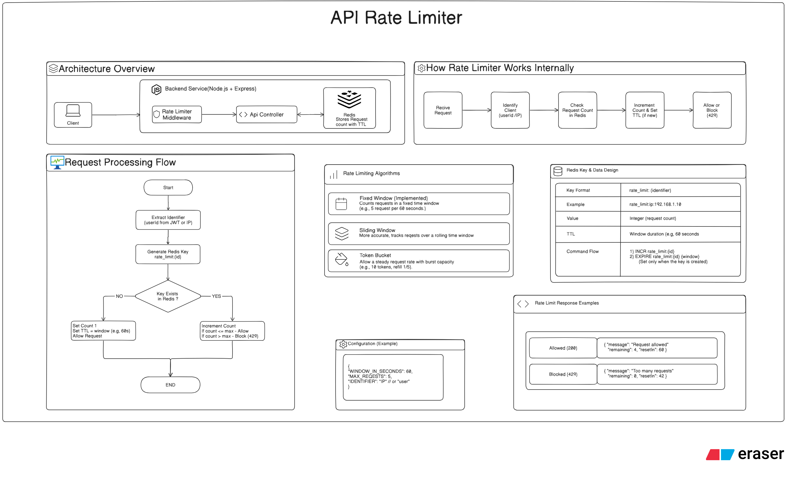

# API Rate Limiter System Design

[text](Images) 
## 1. Overview

This document describes an API rate-limiting service built with
**Node.js**, **Express.js**, and **Redis**.

The rate limiter controls how many requests a client can make during a
configured time window. It identifies a client using a configured
identifier, such as an IP address or authenticated user ID, stores the
request count in Redis, and either allows the request or rejects it with
HTTP `429 Too Many Requests`.

The current design implements the **Fixed Window Counter** algorithm.

### Main goals

-   Protect backend APIs from excessive request traffic.
-   Apply request limits per client identifier.
-   Store counters centrally in Redis so multiple backend instances can
    share rate-limit state.
-   Automatically reset counters using Redis key expiration (TTL).
-   Return a clear response when a client exceeds its limit.
-   Keep rate-limit settings configurable.

> A rate limiter is an admission-control mechanism. It decides whether a
> request may continue to the API controller; it does not replace
> authentication, authorization, or application-level validation.

## 2. Architecture at a glance

``` text
                    Client / HTTP Request
                             |
                             v
                   Node.js + Express Server
                             |
                             v
                    Rate Limiter Middleware
                             |
                 Extract client identifier
                    (user ID or IP)
                             |
                             v
                     Generate Redis key
                 rate_limit:{identifier}
                             |
                             v
                         Redis
                 Read / increment counter
                    and manage TTL
                             |
                  +----------+----------+
                  |                     |
             Within limit           Over limit
                  |                     |
                  v                     v
          Continue to controller   Return HTTP 429
                  |
                  v
             API Controller
                  |
                  v
             JSON Response
```

The Express middleware runs before the API controller. It checks the
request count in Redis and calls `next()` only when the request is
allowed.

## 3. Main components

### 3.1 Client

The client can be a browser application, mobile application, Postman, or
another HTTP client.

It sends requests to the backend API and receives one of two outcomes:

-   **Allowed:** the request continues through the Express middleware
    stack.
-   **Blocked:** the server returns HTTP `429 Too Many Requests`.

### 3.2 Node.js and Express server

The backend runs on Node.js and uses Express.js to handle HTTP requests.

Responsibilities:

1.  Initialize the Express application.
2.  Load rate-limit configuration.
3.  Register the rate-limiter middleware before protected routes.
4.  Connect to Redis before accepting requests.
5.  Continue allowed requests to the relevant controller.
6.  Return a rate-limit response when a client exceeds the configured
    limit.

### 3.3 Rate limiter middleware

The middleware is the central decision-making component.

Responsibilities:

1.  Identify the client using the configured identifier.
2.  Generate a Redis key for that identifier.
3.  Read or increment the request counter.
4.  Set the window TTL when a new counter is created.
5.  Compare the count with the maximum allowed request count.
6.  Call `next()` when the request is allowed.
7.  Return HTTP `429` when the limit is exceeded.

The middleware should handle Redis errors deliberately. A production
service must define whether it should fail open (allow the request) or
fail closed (reject the request) when Redis is unavailable. That policy
depends on the API's security, availability, and abuse-risk
requirements.

### 3.4 Redis

Redis stores the request counter for each client identifier.

Example key:

``` text
rate_limit:ip:192.168.1.10
```

The key's value is an integer representing the number of requests
counted in the current fixed window. Its TTL determines when the counter
expires.

Redis is shared infrastructure: if several Express instances use the
same Redis deployment and key convention, they can enforce a common rate
limit rather than maintaining separate in-memory counters.

### 3.5 API controller

The API controller contains the business logic for the requested
endpoint.

It should run only after the rate-limiter middleware has allowed the
request. The rate limiter should remain separate from controller
business logic so it can be reused across routes.

## 4. Rate-limiting algorithm

The diagram identifies three common algorithms and marks **Fixed
Window** as the implemented algorithm.

  -----------------------------------------------------------------------
  Algorithm               How it works            Characteristics
  ----------------------- ----------------------- -----------------------
  Fixed Window            Counts requests in a    Simple and
                          fixed time interval     memory-efficient, but
                                                  can allow a burst
                                                  around a window
                                                  boundary

  Sliding Window          Tracks requests over a  More accurate over
                          rolling time interval   time, but generally
                                                  requires more state or
                                                  computation

  Token Bucket            Adds tokens at a steady Supports controlled
                          rate and spends one per bursts while
                          request                 maintaining an average
                                                  request rate
  -----------------------------------------------------------------------

### 4.1 Fixed Window Counter (implemented)

Example configuration:

-   Window duration: `60` seconds
-   Maximum requests: `5`
-   Identifier: client IP address or authenticated user ID

The counter is associated with a Redis key. The first request creates
the counter and starts its TTL. Subsequent requests increment the
counter while the key exists.

Decision rule:

``` text
If request count <= MAX_REQUESTS:
    Allow request
Else:
    Block request with HTTP 429
```

With a maximum of 5 requests per 60-second window:

-   Requests 1 through 5 are allowed.
-   Request 6 and later requests in that same window are blocked.
-   When the Redis key expires, the next request starts a new window.

**Fixed-window boundary behavior:** a client can make requests near the
end of one window and again immediately after the next window begins.
This can produce a short burst larger than the configured limit over a
rolling 60-second period. Consider a sliding-window or token-bucket
design if this behavior is unacceptable.

## 5. Request processing flow

### 5.1 High-level middleware flow

``` text
Start
  |
  v
Receive HTTP request
  |
  v
Extract client identifier
(user ID or IP address)
  |
  v
Generate Redis key
rate_limit:{identifier}
  |
  v
Check / increment request counter in Redis
  |
  v
Is request count within MAX_REQUESTS?
  |                         |
 Yes                         No
  |                          |
  v                          v
Allow request             Return HTTP 429
  |
  v
Continue to API controller
  |
  v
Return controller response
```

### 5.2 Counter initialization and increment

The logical counter flow shown in the design is:

``` text
1. Generate the Redis key for the client.

2. If the key does not exist:
   - Set the counter to 1.
   - Set the TTL to WINDOW_IN_SECONDS.
   - Allow the request.

3. If the key already exists:
   - Increment the counter.
   - If the count is <= MAX_REQUESTS, allow the request.
   - Otherwise, block the request with HTTP 429.
```

A representative Redis command flow is:

``` redis
INCR rate_limit:ip:192.168.1.10
EXPIRE rate_limit:ip:192.168.1.10 60
TTL rate_limit:ip:192.168.1.10
```

The `EXPIRE` operation should be applied when the counter is first
created, not reset on every request. Resetting the TTL on every request
would change the behavior into a different kind of inactivity-based
window.

**Concurrency consideration:** a separate `INCR` followed by `EXPIRE`
can leave a counter without an expiry if the application crashes between
the commands. Also, the check/increment/first-expiry sequence should be
atomic when multiple requests can arrive concurrently. A Redis Lua
script or another atomic Redis operation can perform the counter update,
first-time TTL assignment, and limit decision as one operation.

## 6. Redis key and data design

### 6.1 Key format

``` text
rate_limit:{identifier}
```

Example:

``` text
rate_limit:ip:192.168.1.10
```

Possible identifier formats:

``` text
rate_limit:ip:192.168.1.10
rate_limit:user:12345
```

The identifier must be chosen consistently. For authenticated endpoints,
a stable user ID is usually more meaningful than an IP address. For
unauthenticated endpoints, the client IP may be used.

If the application runs behind a reverse proxy or load balancer,
configure Express's `trust proxy` setting carefully before relying on
`req.ip`. Otherwise, the application may identify the proxy rather than
the original client, or trust spoofed forwarding headers.

### 6.2 Stored value and TTL

  ------------------------------------------------------------------------------
  Field                   Description             Example
  ----------------------- ----------------------- ------------------------------
  Key                     Identifier-specific     `rate_limit:ip:192.168.1.10`
                          counter key             

  Value                   Integer request count   `4`

  TTL                     Remaining lifetime of   `60` seconds at creation
                          the current window      

  Window                  Configured fixed-window `60` seconds
                          duration                
  ------------------------------------------------------------------------------

Redis automatically removes the counter after its TTL expires.

### 6.3 Redis commands

  Command                Purpose
  ---------------------- -------------------------------------------
  `INCR key`             Atomically increments the integer counter
  `EXPIRE key seconds`   Sets the key's expiration
  `TTL key`              Reads the remaining key lifetime
  `GET key`              Reads the current counter value

The exact command sequence should ensure that the TTL is set only for a
newly created counter and that concurrent requests cannot bypass the
limit decision.

## 7. Configuration

Example configuration from the design:

``` javascript
{
  WINDOW_IN_SECONDS: 60,
  MAX_REQUESTS: 5,
  IDENTIFIER: "IP" // or "user"
}
```

  ------------------------------------------------------------------------
  Setting                                    Example Meaning
  --------------------- ---------------------------- ---------------------
  `WINDOW_IN_SECONDS`                           `60` Duration of the fixed
                                                     window

  `MAX_REQUESTS`                                 `5` Maximum allowed
                                                     requests per
                                                     identifier in one
                                                     window

  `IDENTIFIER`                                  `IP` Identity strategy: IP
                                                     address or
                                                     authenticated user
  ------------------------------------------------------------------------

These are example values. Production limits should be selected based on
endpoint behavior, expected traffic, user tiers, and abuse risk.
Different routes may need different limits.

## 8. API behavior and response examples

The diagram defines the rate-limiter outcomes but does not prescribe a
specific application endpoint. The following examples describe the
middleware's HTTP behavior.

### 8.1 Allowed request

**HTTP status:** `200 OK` (the actual status is determined by the API
controller).

Example response body:

``` json
{
  "message": "Request allowed",
  "remaining": 4,
  "resetIn": 60
}
```

`remaining` is the number of requests still available in the current
window after counting the current request. `resetIn` is the remaining
window time in seconds.

### 8.2 Blocked request

**HTTP status:** `429 Too Many Requests`

Example response body:

``` json
{
  "message": "Too many requests",
  "remaining": 0,
  "resetIn": 42
}
```

The `resetIn` value should be based on the Redis key's remaining TTL.
The middleware can also return standard rate-limit headers, such as a
limit, remaining count, and reset time, if the API contract defines
them.

## 9. Deployment architecture

The logical deployment contains:

-   **Node.js + Express:** receives requests and runs the rate-limiter
    middleware.
-   **Redis:** stores shared request counters and their TTLs.
-   **Docker Compose:** can run the backend and Redis services together
    during local development or deployment.

A production deployment should protect Redis from public access,
configure authentication and network access appropriately, and monitor
Redis availability and memory usage.

The design image does not specify a Docker image, persistence policy,
Redis topology, or deployment platform; those are implementation
decisions.

## 10. Suggested project structure

``` text
api-rate-limiter/
├── config/
│   ├── redis.js
│   └── rateLimitConfig.js
├── middleware/
│   └── rateLimiter.js
├── routes/
│   └── exampleRoutes.js
├── controllers/
│   └── exampleController.js
├── app.js
├── server.js
├── docker-compose.yml
├── .env
├── .env.example
└── package.json
```

  ------------------------------------------------------------------------
  File                                 Responsibility
  ------------------------------------ -----------------------------------
  `config/redis.js`                    Creates and exports the Redis
                                       client and connection function

  `config/rateLimitConfig.js`          Holds the window, maximum request
                                       count, and identifier strategy

  `middleware/rateLimiter.js`          Identifies clients, updates Redis
                                       counters, and allows or blocks
                                       requests

  `routes/exampleRoutes.js`            Defines routes protected by the
                                       middleware

  `controllers/exampleController.js`   Implements endpoint business logic

  `app.js`                             Configures Express and registers
                                       middleware and routes

  `server.js`                          Connects to Redis and starts the
                                       HTTP server

  `docker-compose.yml`                 Defines local backend and Redis
                                       services
  ------------------------------------------------------------------------

## 11. Error handling and operational considerations

  -----------------------------------------------------------------------
  Scenario                            Expected behavior
  ----------------------------------- -----------------------------------
  Request is within the configured    Continue to the controller
  limit                               

  Request exceeds the configured      Return HTTP `429`
  limit                               

  Identifier cannot be determined     Apply an explicit fallback or
                                      reject according to the API policy

  Redis is unavailable                Apply the configured fail-open or
                                      fail-closed policy and log the
                                      error

  Redis command fails                 Handle the error without
                                      accidentally treating it as an
                                      allowed request

  Redis key expires                   The next request starts a new fixed
                                      window

  Client is behind a proxy            Use a correctly configured
                                      trusted-proxy policy to determine
                                      the client IP
  -----------------------------------------------------------------------

Additional considerations:

-   Do not use a process-local in-memory counter if multiple backend
    instances must share one global limit.
-   Use an atomic Redis operation for counter increment, initial TTL
    assignment, and limit evaluation.
-   Avoid resetting the TTL on every request in a fixed-window
    implementation.
-   Use authenticated user IDs when per-user limits are required.
-   Consider separate limits for login, registration, public APIs, and
    expensive operations.
-   Avoid logging sensitive authentication tokens or unnecessary
    personal data.
-   Monitor blocked-request counts, Redis latency, Redis errors, and key
    memory usage.

## 12. Testing strategy

The API can be tested manually with Postman and automatically with Jest
and Supertest. Redis behavior should be tested against an isolated test
instance or a controlled test database.

### Middleware behavior

-   Allow a request when the counter is below the configured limit.
-   Allow the request that reaches the configured maximum.
-   Block the next request after the maximum is reached.
-   Return HTTP `429` with the expected response body.
-   Verify that different identifiers have independent counters.
-   Verify that the same identifier shares a counter across requests.

### TTL behavior

-   Verify that the first request creates a counter with the configured
    TTL.
-   Verify that later requests increment the same counter.
-   Verify that later requests do not unintentionally reset the
    fixed-window TTL.
-   Verify that a request after key expiration starts a new window.
-   Verify the reset time returned to the client.

### Reliability and concurrency

-   Handle Redis connection failures.
-   Handle Redis command failures.
-   Send concurrent requests and verify that the limit is not exceeded
    due to race conditions.
-   Verify that the counter receives an expiry even under concurrent
    first requests.
-   Verify the configured fail-open or fail-closed behavior.

### Identifier behavior

-   Verify IP-based identification.
-   Verify authenticated user-based identification.
-   Verify behavior behind a trusted reverse proxy.
-   Verify that one client cannot choose another client's identifier
    through an untrusted request header.

## 13. Limitations and trade-offs

### Fixed-window boundary bursts

The fixed-window algorithm resets at a fixed boundary. A client may use
its full quota just before the boundary and another full quota just
after it. This can allow a short burst larger than the nominal limit
over a rolling interval.

### Redis dependency

The middleware depends on Redis to share and update counters. Redis
availability and latency directly affect rate-limit decisions. The
application needs an explicit policy for Redis outages.

### Identifier quality

IP-based limits can group many users behind a shared NAT or proxy. They
can also be inaccurate if proxy headers are not configured securely.
User-based limits require a trustworthy authenticated identity.

### Atomicity

A non-atomic sequence of counter and TTL operations can produce
inconsistent state under failures or concurrency. Use a Redis Lua script
or another atomic strategy for a robust implementation.

### Fixed policy

A single global limit may not suit every endpoint or user category.
Route-specific or tier-specific policies may be needed as the
application grows.

## 14. Recommended implementation sequence

1.  Create the Node.js and Express application.
2.  Configure Redis and verify the connection.
3.  Add the rate-limit configuration.
4.  Implement client identification (IP or authenticated user ID).
5.  Generate a Redis key for each identifier.
6.  Implement the fixed-window counter and initial TTL.
7.  Make the counter update and limit decision atomic.
8.  Add middleware that calls `next()` for allowed requests.
9.  Return HTTP `429` for blocked requests.
10. Add response metadata such as remaining requests and reset time.
11. Test normal, boundary, concurrent, and Redis-failure scenarios.
12. Run multiple backend instances against the same Redis service and
    verify shared limits.

## 15. Summary

The API Rate Limiter uses **Node.js**, **Express.js**, and **Redis** to
restrict the number of requests a client can make during a fixed time
window.

The Express middleware identifies the client, generates a Redis key,
increments the request counter, and uses the key's TTL to track the
window. Requests within the configured limit continue to the API
controller; requests above the limit receive HTTP
`429 Too Many Requests`.

The example configuration allows 5 requests per 60-second window and
supports either IP-based or user-based identification.

**Key principle:** the rate-limiter middleware must make a reliable,
shared, and concurrency-safe allow-or-block decision before the request
reaches the API controller.
