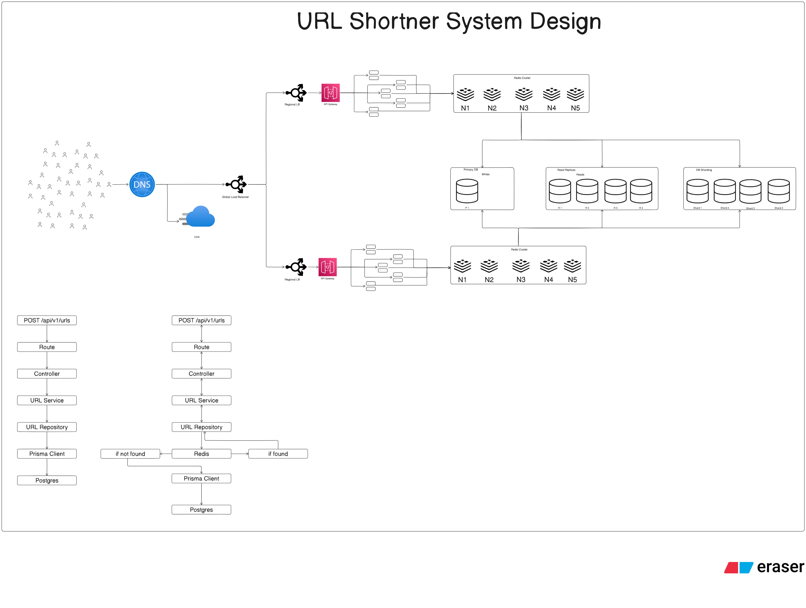
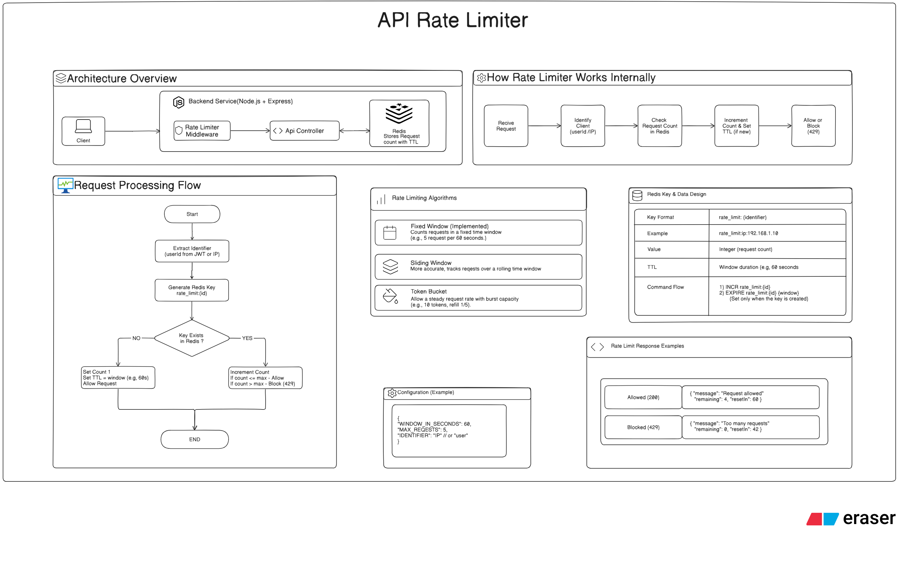
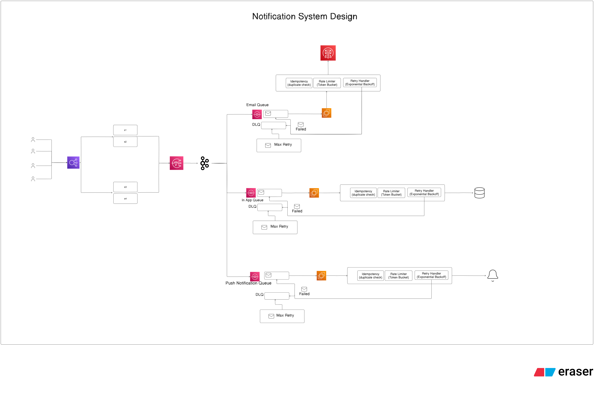
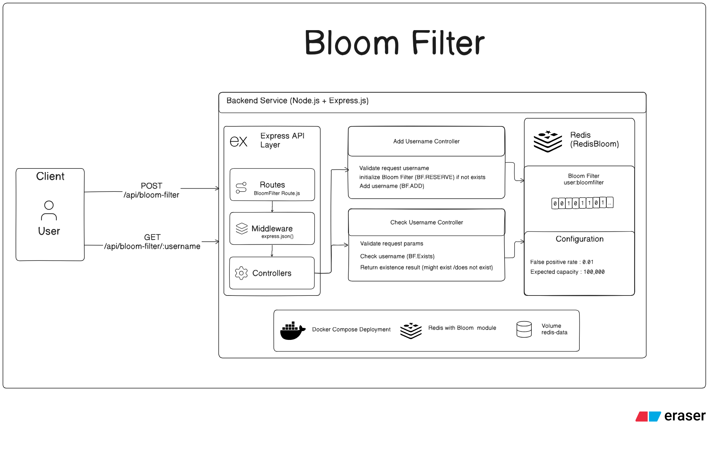

# System Designs

A collection of system design documents I've developed while studying and practicing system design. Each design is written as a standalone Markdown document covering requirements, architecture, component deep-dives, data models, scaling strategies, failure scenarios, and trade-offs — paired with a system architecture diagram.

---

## 📚 Designs

| # | Design | Diagram | Highlights |
|---|--------|---------|------------|
| 1 | [URL Shortener](URL-Shortener-System-Design.md) |  | Short-code generation, Redis caching, redirect resolution, database scaling |
| 2 | [API Rate Limiter](API-Rate-Limiter-System-Design.md) |  | Rate-limiting algorithms (Token Bucket, Sliding Window…), Redis key design, failure scenarios |
| 3 | [Notification System](Notification-System-Design.md) |  | Multi-channel delivery, reliability mechanisms, end-to-end processing flows, observability |
| 4 | [Bloom Filter](BloomFilter-System-Design.md) |  | Probabilistic data structures, false-positive trade-offs, configuration tuning, use cases |

---

## 📖 What's Inside

Every document follows a consistent structure:

1. **Overview & goals** — what the system does and why
2. **Requirements** — functional and non-functional
3. **High-level architecture** — components and how they connect
4. **Deep dives** — core algorithms, data models, caching, and storage design
5. **End-to-end flows** — request/response walkthroughs
6. **Scaling strategy** — how the system grows with load
7. **Failure scenarios & reliability** — what breaks and how we handle it
8. **Monitoring & observability** — metrics, logging, alerting
9. **Trade-offs & limitations** — honest notes on what was sacrificed
10. **Implementation sequence** — a suggested order for building it

---

## 🗂️ Repository Structure

```
System-Designs/
├── README.md
├── URL-Shortener-System-Design.md
├── API-Rate-Limiter-System-Design.md
├── Notification-System-Design.md
├── BloomFilter-System-Design.md
└── Images/
    ├── URL_Shortner_System_Design.png
    ├── API_Rate_Limiter.png
    ├── Notification_System_Design.png
    └── BloomFilter_systemDesign.png
```

- Design docs live at the repository root.
- Architecture diagrams live in [`Images/`](Images/) and are referenced from their respective documents.

---

## 🚀 Usage

Read any document directly on GitHub, or clone the repo:

```bash
git clone https://github.com/Harsh-Koundal/System-Designs.git
cd System-Designs
```

---

## 🤝 Contributing

New design? Contributions are welcome:

1. Create `<Topic>-System-Design.md` at the repository root.
2. Add its diagram to `Images/` (PNG or SVG).
3. Follow the existing document structure (overview → requirements → architecture → deep dives → flows → scaling → failures → trade-offs).
4. Embed the diagram near the top of the document: ``
5. Open a pull request.

---

## 📬 Contact

Questions or feedback? Open an issue or reach out on [GitHub](https://github.com/Harsh-Koundal).
