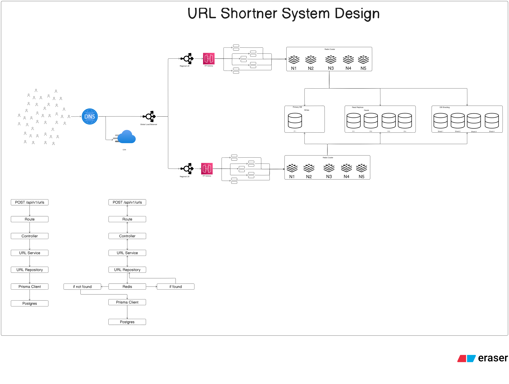

# URL Shortener System Design



## 1. Overview

This document describes a scalable URL-shortening service. The system
accepts a long URL, generates a short identifier, stores the mapping,
and redirects visitors from the short URL to the original destination.

The architecture shown in the design includes:

-   DNS and a CDN at the edge.
-   A global load balancer that routes traffic to regional load
    balancers.
-   Regional API gateways and application-server instances.
-   Redis clusters for fast URL lookups.
-   PostgreSQL as the persistent data store.
-   A primary database, read replicas, and database shards.
-   A layered backend implementation using routes, controllers,
    services, repositories, Prisma, and PostgreSQL.

The design separates URL creation from short-link resolution. Creation
persists a new mapping, while resolution checks Redis first and falls
back to PostgreSQL when the mapping is not cached.

## 2. Goals and requirements

### 2.1 Functional requirements

1.  Accept a long URL and create a short URL.
2.  Generate a unique short code for each mapping.
3.  Persist the short-code-to-original-URL mapping.
4.  Resolve a short code to its original URL.
5.  Redirect the visitor to the original URL.
6.  Cache frequently accessed mappings in Redis.
7.  Return an appropriate response when a short code does not exist.

### 2.2 Non-functional requirements

-   **Low redirect latency:** most redirect requests should be served
    from Redis.
-   **Availability:** the service should continue operating across
    application instances and regions where the deployment supports it.
-   **Scalability:** application servers, Redis capacity, and database
    capacity should be expandable.
-   **Durability:** URL mappings must be stored in persistent database
    storage.
-   **Uniqueness:** two different URLs must not accidentally receive the
    same active short code.
-   **Consistency:** a newly created mapping should be resolvable after
    successful creation.

## 3. High-level architecture

``` text
                         Users / Clients
                                |
                                v
                               DNS
                                |
                  +-------------+-------------+
                  |                           |
                  v                           v
                 CDN                  Global Load Balancer
                                              |
                              +---------------+---------------+
                              |                               |
                              v                               v
                       Regional LB 1                    Regional LB 2
                              |                               |
                              v                               v
                         API Gateway                     API Gateway
                              |                               |
                              v                               v
                     Application Servers              Application Servers
                              |                               |
                              v                               v
                       Redis Cluster 1                  Redis Cluster 2
                              |                               |
                              +---------------+---------------+
                                              |
                                              v
                                      Database Layer
                                              |
                    +-------------------------+-------------------------+
                    |                         |                         |
                    v                         v                         v
                Primary DB               Read Replicas              DB Shards
                 (Writes)                   (Reads)                (Partitioned data)
```

The diagram shows two regional request paths, each with a regional load
balancer, API gateway, application instances, and a Redis cluster. The
database layer contains a primary database for writes, read replicas for
reads, and database shards for horizontal data distribution.

This is a logical architecture. The exact replication topology,
shard-routing strategy, failover behavior, and cross-region consistency
model need to be selected during implementation.

## 4. Main components

### 4.1 Client

A client can be a browser, mobile application, frontend application, or
another service.

It performs two main operations:

-   Submit a long URL to create a short link.
-   Open a short link to be redirected to the original URL.

### 4.2 DNS

DNS resolves the URL shortener's domain name to the appropriate edge or
load-balancing endpoint.

It is the first routing step shown in the architecture.

### 4.3 CDN

The CDN sits near the edge and can serve cacheable content without
sending every request through the origin infrastructure.

The diagram includes a CDN alongside the global load-balancing path. It
does not specify a CDN caching policy for redirects. Redirect caching
should be configured deliberately because destination changes, link
expiration, and access-control rules can make cached redirects stale or
inappropriate.

### 4.4 Global load balancer

The global load balancer distributes incoming traffic across regional
deployments.

Responsibilities:

1.  Select a healthy region.
2.  Route traffic to the selected regional load balancer.
3.  Support regional traffic distribution and failover according to
    deployment policy.

The diagram shows traffic split across two regional paths.

### 4.5 Regional load balancer

Each region has a regional load balancer in front of its API gateway and
application instances.

Responsibilities:

-   Distribute requests across healthy application instances.
-   Avoid sending traffic to unhealthy instances.
-   Support scaling within the region.

### 4.6 API gateway

The API gateway is the entry point to the regional backend services.

Typical responsibilities include:

-   Route requests to the appropriate backend service.
-   Apply authentication and request validation where required.
-   Enforce request-size and traffic policies.
-   Apply rate limiting if configured.
-   Centralize request logging and tracing.

The diagram identifies an API gateway but does not define its specific
policies.

### 4.7 Application servers

The application layer contains multiple backend instances.

Each instance runs the same URL-shortener application and handles
requests through the route, controller, service, and repository layers.

Multiple instances allow the service to scale horizontally. Shared Redis
and database infrastructure allow instances to access common URL
mappings.

### 4.8 Redis cluster

Redis is used as a cache for short-code lookups.

The diagram shows Redis nodes labelled N1 through N5 in each regional
Redis cluster.

Responsibilities:

-   Store short-code-to-original-URL cache entries.
-   Serve frequent redirect lookups quickly.
-   Reduce repeated reads against PostgreSQL.
-   Share cached data across application instances in the same
    configured cache deployment.

A possible cache key format is:

``` text
url:{shortCode}
```

Example:

``` text
url:aB91xQ
```

Example value:

``` text
https://example.com/articles/system-design
```

A cache entry should have an expiration policy appropriate to the link's
lifetime and update behavior. The diagram does not specify a TTL.

### 4.9 PostgreSQL

PostgreSQL is the persistent source of URL mappings.

The lower-level flow in the diagram shows Prisma Client communicating
with PostgreSQL through the URL repository layer.

The database stores the mapping between a short code and its original
URL, along with any additional metadata required by the application.

### 4.10 Primary database, read replicas, and sharding

The database section of the architecture shows three database roles:

  Database component   Role
  -------------------- ------------------------------------------------
  Primary DB           Handles writes
  Read replicas        Serve read traffic
  DB shards            Partition data across multiple database groups

**Primary database:** URL creation writes the new mapping to the primary
database.

**Read replicas:** read-heavy operations can be distributed across
replicas. Replication lag must be considered: a recently created URL may
not immediately be visible on every replica.

**Database sharding:** as the mapping dataset grows, records can be
partitioned across shards. The application or a routing layer must
determine which shard owns a given short code.

The diagram establishes these components at a high level; it does not
specify a shard key, replica count, or database failover mechanism.

## 5. Backend application architecture

The lower part of the design shows a layered backend structure.

``` text
HTTP Request
     |
     v
   Route
     |
     v
 Controller
     |
     v
 URL Service
     |
     v
URL Repository
     |
     +----------------------+
     |                      |
     v                      v
   Redis                Prisma Client
     |                      |
     |                 PostgreSQL
     |
     v
 Cache result / cache miss
```

### 5.1 Route layer

The route layer maps HTTP methods and paths to controller functions.

It should remain responsible for request routing and route-level
middleware rather than containing database or cache logic.

### 5.2 Controller layer

The controller:

1.  Reads route parameters or request-body values.
2.  Performs or invokes request validation.
3.  Calls the relevant URL service method.
4.  Converts the service result into an HTTP response.

The controller should not directly implement Redis or Prisma queries.

### 5.3 URL service

The URL service contains the main application use cases.

Typical responsibilities:

-   Create a short URL.
-   Generate or obtain a short code.
-   Resolve a short code.
-   Coordinate repository and cache operations.
-   Apply business rules such as expiration or custom aliases if
    supported.

### 5.4 URL repository

The repository abstracts data access.

In this design it coordinates URL lookup and persistence through Redis
and Prisma Client.

A clear implementation can separate persistent database operations from
cache operations into dedicated repositories or adapters, while keeping
the URL service responsible for coordinating them.

### 5.5 Prisma Client

Prisma Client is the ORM layer used by the backend to interact with
PostgreSQL.

It provides typed database queries and persistence operations for URL
records.

### 5.6 PostgreSQL

PostgreSQL stores the durable URL mapping. Redis is a cache and should
not be the only place where a newly created mapping exists.

## 6. URL creation flow

The left-hand lower flow in the diagram shows URL creation:

``` text
Client
  |
  v
POST /api/v1/urls
  |
  v
Route
  |
  v
Controller
  |
  v
URL Service
  |
  v
URL Repository
  |
  v
Prisma Client
  |
  v
PostgreSQL
  |
  v
Return short URL
```

### 6.1 Step-by-step

1.  The client sends a long URL to the creation endpoint.
2.  The route forwards the request to the controller.
3.  The controller validates the request and calls the URL service.
4.  The URL service generates a unique short code.
5.  The URL repository persists the short-code mapping using Prisma
    Client.
6.  PostgreSQL stores the mapping.
7.  The service returns the generated short URL to the controller.
8.  The controller returns the response to the client.

### 6.2 Example request

The diagram labels the creation endpoint as:

``` http
POST /api/v1/urls
Content-Type: application/json
```

Example request body:

``` json
{
  "longUrl": "https://example.com/articles/system-design"
}
```

### 6.3 Example success response

The following response is an illustrative API contract; the diagram does
not define exact response fields.

``` json
{
  "success": true,
  "shortCode": "aB91xQ",
  "shortUrl": "https://short.example/aB91xQ",
  "originalUrl": "https://example.com/articles/system-design"
}
```

The short code must be unique. A database unique constraint should
enforce this requirement even if the application generates codes that
are expected to be unique.

## 7. Short-code generation

The diagram requires a generated short identifier but does not specify
the generation algorithm.

A common approach is to generate a random or encoded identifier using a
URL-safe alphabet.

Example:

``` text
Original URL:
https://example.com/articles/system-design

Generated short code:
aB91xQ

Short URL:
https://short.example/aB91xQ
```

### 7.1 Uniqueness

Short-code collisions must be handled safely.

Recommended behavior:

1.  Generate a candidate code.
2.  Attempt to insert the mapping into PostgreSQL.
3.  If the unique constraint reports a collision, generate another code.
4.  Retry a bounded number of times.
5.  Return an error if a unique code cannot be generated.

Do not rely only on an application-side existence check; concurrent
requests can generate the same candidate. The database unique constraint
is the final protection.

### 7.2 Possible generation strategies

  -----------------------------------------------------------------------
  Strategy                Description             Trade-off
  ----------------------- ----------------------- -----------------------
  Random code             Generate a random       Simple, but collisions
                          URL-safe string         must be handled

  Base62 ID               Encode a numeric ID     Compact and
                          using letters and       deterministic, but IDs
                          digits                  may be guessable

  Hash-based code         Derive a code from the  Requires collision
                          original URL            handling and careful
                                                  treatment of duplicate
                                                  URLs
  -----------------------------------------------------------------------

The appropriate strategy depends on whether the service needs
unguessable links, deterministic behavior, custom aliases, or compact
identifiers.

## 8. URL redirect / resolution flow

The right-hand lower flow shows the URL lookup path through Redis, with
PostgreSQL as the fallback when the cache does not contain the mapping.

The diagram labels both lower request paths as `POST /api/v1/urls`. It
does not show a distinct redirect HTTP method or path. For a
conventional short-link service, the redirect operation would normally
use `GET /:shortCode`; this is a recommended interpretation, not a label
explicitly present in the diagram.

``` text
Visitor opens short URL
        |
        v
GET /:shortCode
        |
        v
      Route
        |
        v
    Controller
        |
        v
    URL Service
        |
        v
   URL Repository
        |
        v
      Redis
        |
        v
    Cache hit?
      /    \
    Yes     No
     |       |
     v       v
Return     Prisma Client
redirect       |
               v
           PostgreSQL
               |
               v
         Mapping found?
            /     \
          Yes      No
           |        |
           v        v
      Cache result  Return 404
           |
           v
     Return redirect
```

### 8.1 Cache hit

1.  The visitor requests a short URL.
2.  The request reaches the URL service through the route and
    controller.
3.  The URL repository checks Redis using the short code.
4.  Redis returns the original URL.
5.  The application responds with an HTTP redirect to the original URL.

This avoids a database query for a cached mapping.

### 8.2 Cache miss

1.  The repository checks Redis and finds no entry.
2.  It queries PostgreSQL through Prisma Client.
3.  If the mapping exists, the application obtains the original URL.
4.  The mapping is added to Redis for subsequent requests.
5.  The application responds with an HTTP redirect.

### 8.3 Short code not found

If the mapping does not exist in Redis or PostgreSQL, return HTTP
`404 Not Found`.

The service can optionally cache a short-lived negative result to reduce
repeated database queries for nonexistent codes. This behavior is not
shown in the diagram and should be added only if appropriate.

### 8.4 Redirect status

Common redirect status codes include:

  -----------------------------------------------------------------------
  Status                  Meaning                 Typical use
  ----------------------- ----------------------- -----------------------
  `301`                   Moved Permanently       Permanent redirect that
                                                  may be cached by
                                                  clients

  `302`                   Found                   Temporary redirect

  `307`                   Temporary Redirect      Temporary redirect that
                                                  preserves the HTTP
                                                  method

  `308`                   Permanent Redirect      Permanent redirect that
                                                  preserves the HTTP
                                                  method
  -----------------------------------------------------------------------

For a URL shortener, choose the status based on whether destinations can
change and whether browser or intermediary caching is desired. A
temporary redirect such as `302` is a reasonable initial default when
link destinations may be edited.

## 9. Redis caching strategy

### 9.1 Cache-aside pattern

The lookup flow follows the cache-aside pattern:

-   Read from Redis first.
-   On a cache hit, return the cached destination.
-   On a cache miss, read from PostgreSQL.
-   Populate Redis after a successful database lookup.

### 9.2 Example Redis operations

The exact Redis commands depend on the Redis client library.
Conceptually, the operations are:

``` text
GET url:{shortCode}
SET url:{shortCode} {originalUrl} EX {ttl}
```

Example:

``` text
GET url:aB91xQ

SET url:aB91xQ https://example.com/articles/system-design EX 86400
```

The example TTL of 86,400 seconds is illustrative only. The diagram does
not specify a cache duration.

### 9.3 Cache invalidation

If a URL destination can be edited or a short link can be deleted, the
cache must be updated or invalidated.

Possible strategies:

-   Delete the Redis key after a successful database update.
-   Update the cached value after a successful database update.
-   Use a short TTL to limit how long stale data can remain.

The database write should succeed before the application reports a
successful update. Cache invalidation should be handled reliably,
including retries or an outbox/event mechanism if the system requires
stronger guarantees.

### 9.4 Cache stampede

If a popular key expires, many requests may miss the cache
simultaneously and query PostgreSQL.

Possible mitigations include:

-   Per-key request coalescing.
-   Short randomized TTL variation.
-   Background refresh for very hot keys.
-   A distributed lock where justified.

These are scaling considerations beyond the explicit diagram.

## 10. Database design

The diagram identifies PostgreSQL but does not show a table schema. A
basic URL mapping table could contain:

  Column           Suggested type        Purpose
  ---------------- --------------------- --------------------------
  `id`             UUID or BIGINT        Primary key
  `short_code`     VARCHAR               Unique short identifier
  `original_url`   TEXT                  Destination URL
  `created_at`     TIMESTAMP             Creation time
  `expires_at`     TIMESTAMP, nullable   Optional link expiration
  `user_id`        UUID, nullable        Optional owner reference

Example SQL:

``` sql
CREATE TABLE urls (
    id UUID PRIMARY KEY,
    short_code VARCHAR(32) NOT NULL UNIQUE,
    original_url TEXT NOT NULL,
    created_at TIMESTAMPTZ NOT NULL DEFAULT NOW(),
    expires_at TIMESTAMPTZ NULL,
    user_id UUID NULL
);

CREATE INDEX idx_urls_created_at ON urls (created_at);
```

This is a suggested starting schema, not a schema shown in the
architecture image.

### 10.1 Database constraints and indexes

-   Add a unique constraint on `short_code`.
-   Index columns used in lookup and ownership queries.
-   Validate and normalize URLs before persistence.
-   Define how expired links are treated.
-   Avoid indexing large text fields unless a query requirement
    justifies it.

## 11. Database scaling considerations

### 11.1 Primary and read replicas

The architecture shows one primary database and multiple read replicas.

A common arrangement is:

-   Send URL creation and updates to the primary.
-   Send eligible read queries to replicas.
-   Consider replication lag for recently created or modified links.

A read-after-write requirement may need the redirect lookup to read from
the primary or use a consistency-aware routing policy until replication
catches up.

### 11.2 Sharding

The diagram also shows multiple database shards.

Sharding partitions the URL mapping dataset across database groups. The
application needs a deterministic routing strategy to locate the shard
for a short code.

Possible shard-routing approaches include:

-   Hashing the short code.
-   Assigning ranges of identifiers.
-   Using a dedicated routing directory.

The shard key should distribute traffic and data evenly. The diagram
does not prescribe a particular strategy.

### 11.3 Regional behavior

The architecture shows regional application and Redis clusters. It does
not specify whether URL data is globally replicated, regionally
partitioned, or accessed through a single database region.

Before implementing multi-region writes, define:

-   Which region owns a newly created mapping.
-   How mappings become visible in other regions.
-   How cache entries are propagated or refreshed.
-   What happens during regional network partitions.
-   Whether the system favors availability or strong consistency for
    each operation.

## 12. API design

The diagram explicitly labels the creation endpoint:

``` http
POST /api/v1/urls
```

A conventional redirect endpoint is proposed below to complete the
user-facing URL-shortener behavior.

### 12.1 Create a short URL

**Method and path**

``` http
POST /api/v1/urls
```

**Request**

``` json
{
  "longUrl": "https://example.com/articles/system-design"
}
```

**Illustrative success response**

``` json
{
  "success": true,
  "shortCode": "aB91xQ",
  "shortUrl": "https://short.example/aB91xQ"
}
```

Possible status codes:

-   `201 Created` --- mapping created.
-   `400 Bad Request` --- invalid or missing URL.
-   `409 Conflict` --- custom short code already exists, if custom
    aliases are supported.
-   `500 Internal Server Error` --- unexpected failure.

### 12.2 Resolve a short URL

**Proposed method and path**

``` http
GET /:shortCode
```

**Success behavior**

``` http
HTTP/1.1 302 Found
Location: https://example.com/articles/system-design
```

Possible status codes:

-   `302 Found` --- redirect to the destination.
-   `404 Not Found` --- short code does not exist.
-   `410 Gone` --- link exists but has expired, if expiration is
    implemented.

### 12.3 Optional link-management endpoints

These are possible future additions and are not shown in the diagram:

  Method     Endpoint                          Purpose
  ---------- --------------------------------- --------------------------------
  `GET`      `/api/v1/urls/:shortCode`         Retrieve link metadata
  `PATCH`    `/api/v1/urls/:shortCode`         Update destination or metadata
  `DELETE`   `/api/v1/urls/:shortCode`         Delete or deactivate a link
  `GET`      `/api/v1/urls/:shortCode/stats`   Retrieve click statistics

## 13. Suggested project structure

``` text
url-shortener/
├── src/
│   ├── config/
│   │   ├── redis.js
│   │   └── database.js
│   ├── routes/
│   │   └── url.routes.js
│   ├── controllers/
│   │   └── url.controller.js
│   ├── services/
│   │   └── url.service.js
│   ├── repositories/
│   │   └── url.repository.js
│   ├── utils/
│   │   └── shortCode.js
│   ├── middleware/
│   │   └── errorHandler.js
│   ├── app.js
│   └── server.js
├── prisma/
│   └── schema.prisma
├── docker-compose.yml
├── .env
├── .env.example
└── package.json
```

  -----------------------------------------------------------------------
  File                                Responsibility
  ----------------------------------- -----------------------------------
  `config/redis.js`                   Creates and manages the Redis
                                      client

  `config/database.js`                Initializes the Prisma database
                                      client

  `routes/url.routes.js`              Defines URL creation and redirect
                                      routes

  `controllers/url.controller.js`     Handles HTTP input and output

  `services/url.service.js`           Implements URL creation and
                                      resolution use cases

  `repositories/url.repository.js`    Reads and writes URL mappings and
                                      coordinates cache access

  `utils/shortCode.js`                Generates short codes

  `middleware/errorHandler.js`        Handles application errors
                                      consistently

  `app.js`                            Configures Express and registers
                                      routes

  `server.js`                         Connects infrastructure and starts
                                      the server

  `prisma/schema.prisma`              Defines PostgreSQL models
  -----------------------------------------------------------------------

## 14. Error handling and operational considerations

  -----------------------------------------------------------------------
  Scenario                            Expected behavior
  ----------------------------------- -----------------------------------
  Missing long URL                    Return HTTP `400`

  Invalid URL format                  Return HTTP `400`

  Short-code collision                Generate another code or return a
                                      conflict for a user-supplied alias

  Redis cache hit                     Return the cached destination

  Redis cache miss                    Query PostgreSQL

  Mapping found in PostgreSQL         Populate cache and redirect

  Mapping not found                   Return HTTP `404`

  Link expired                        Return HTTP `410` if expiration is
                                      supported

  Redis unavailable                   Fall back to PostgreSQL where safe,
                                      and record the cache failure

  PostgreSQL unavailable              Return an appropriate server error
                                      if the mapping cannot be resolved

  Database write fails                Do not report URL creation as
                                      successful
  -----------------------------------------------------------------------

Additional considerations:

-   Keep PostgreSQL as the durable source of truth.
-   Enforce short-code uniqueness in the database.
-   Validate URL schemes and reject unsafe schemes such as
    `javascript:`.
-   Define an expiration policy for both links and cache entries.
-   Monitor cache hit ratio, redirect latency, database query latency,
    and error rates.
-   Avoid logging sensitive query parameters or private destination URLs
    unnecessarily.
-   Configure health checks and graceful shutdown for application and
    infrastructure clients.

## 15. Testing strategy

The application can be tested with Jest and Supertest, with an isolated
PostgreSQL database and Redis instance for integration tests.

### 15.1 URL creation tests

-   Create a short URL from a valid long URL.
-   Reject a missing URL.
-   Reject an invalid URL.
-   Verify the generated short code is persisted.
-   Verify the short code is unique.
-   Simulate a collision and verify retry behavior.
-   Verify database errors are handled.

### 15.2 Redirect tests

-   Resolve a short code that exists in Redis.
-   Resolve a short code that is absent from Redis but exists in
    PostgreSQL.
-   Verify a database result is cached.
-   Return `404` for an unknown short code.
-   Return the expected status for an expired link.
-   Verify the redirect `Location` header.

### 15.3 Cache tests

-   Verify cache hits do not require a database lookup.
-   Verify cache misses query PostgreSQL.
-   Verify the configured TTL.
-   Verify cache invalidation after a destination update or deletion.
-   Verify behavior when Redis is unavailable.

### 15.4 Scaling and reliability tests

-   Run multiple application instances against shared Redis.
-   Send concurrent requests for the same short code.
-   Test database read-replica lag if replicas are used.
-   Test shard routing if sharding is implemented.
-   Test regional failure and recovery if multi-region deployment is
    implemented.

## 16. Limitations and trade-offs

### Redis is not the source of truth

Redis is used to accelerate reads. Persistent URL mappings must remain
in PostgreSQL so they can be recovered after cache eviction or Redis
failure.

### Cache consistency

If a destination is changed or a link is deleted, stale cache entries
can return outdated destinations unless invalidation or expiration is
handled correctly.

### Short-code collisions

Random or derived codes can collide. Database uniqueness constraints and
collision retry logic are required.

### Read-replica lag

A mapping written to the primary may not be immediately visible on a
read replica. Read-after-write routing may be required.

### Multi-region consistency

The diagram shows multiple regions but does not define the database
replication or conflict-resolution model. Multi-region behavior requires
an explicit consistency and failover design.

### Sharding complexity

Sharding improves horizontal data distribution but adds routing,
migration, rebalancing, and operational complexity. It should be
introduced when a single database or its read replicas are no longer
sufficient.

## 17. Recommended implementation sequence

1.  Create the Node.js and Express application.
2.  Configure Prisma and connect PostgreSQL.
3.  Define the URL mapping model and unique short-code constraint.
4.  Implement short-code generation.
5.  Implement `POST /api/v1/urls`.
6.  Add the URL service and repository layers.
7.  Implement the redirect route, conventionally `GET /:shortCode`.
8.  Configure Redis and implement cache-aside lookup.
9.  Add cache TTL and invalidation behavior.
10. Add validation and centralized error handling.
11. Test cache hits, cache misses, collisions, and missing URLs.
12. Run multiple application instances and verify shared cache behavior.
13. Evaluate read replicas and sharding only when traffic and data size
    require them.
14. Add load tests, metrics, health checks, and deployment automation.

## 18. Summary

The URL Shortener design uses a layered Node.js and Express backend,
Redis caching, and PostgreSQL persistence. Requests enter through DNS
and the global load balancer, are routed to a regional deployment, and
pass through an API gateway to application instances.

For URL creation, the backend validates the long URL, generates a short
code, and persists the mapping in PostgreSQL through Prisma Client and
the repository layer.

For URL resolution, the backend checks Redis first. A cache hit returns
the destination quickly. A cache miss falls back to PostgreSQL, and a
successful database lookup can populate Redis for future requests.

The infrastructure diagram also presents regional deployments, a primary
database, read replicas, and database sharding as scaling components.
Their exact replication, routing, and failover policies remain
implementation decisions.

**Key principle:** PostgreSQL stores the durable short-code mapping,
while Redis accelerates redirect lookups. The cache improves latency,
but correctness must not depend on a cache entry always being present.
